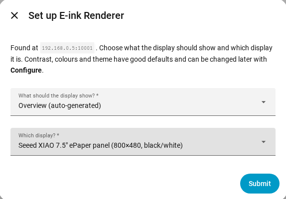
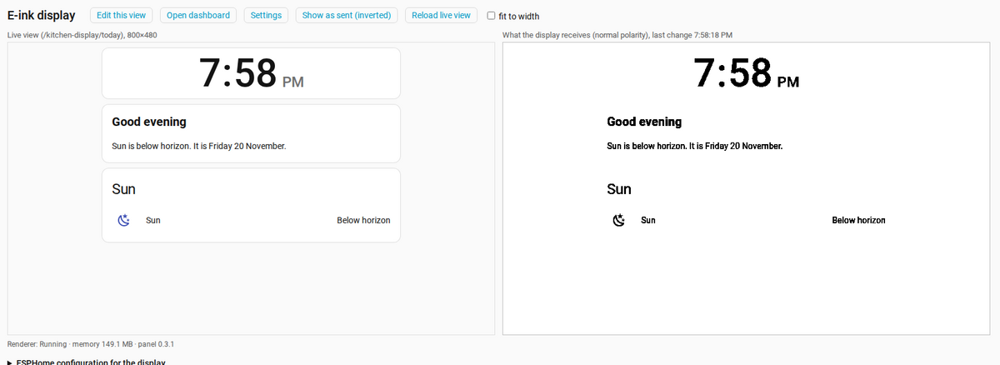

# eink-renderer

Turns a **Home Assistant dashboard into a 1-bit PNG** for e-paper displays, especially ESP32 boards running ESPHome's [`online_image`](https://esphome.io/components/online_image.html). It shows your real Lovelace cards and themes, because it renders them in a real (headless) Chrome and not with a separate widget set.

- **Setup like pairing a device:** run one container with no configuration; Home Assistant discovers it; pick a dashboard view and your display from two dropdowns, look at the preview, done. No tokens, no YAML.
- One small Rust service supervises a pinned `chrome-headless-shell` (start, health check, restart on crash or hang).
- It renders only when the dashboard repaints, not on every request. The image is held in memory and served with `ETag` / `304 Not Modified`. The last good image keeps being served while the browser restarts.
- The **Home Assistant integration** adds a device with an image entity (works over https, remotely and in any card), state, last render, memory and a problem sensor for automations, an **E-ink** sidebar panel that shows the live view next to the exact image your display receives, and the ESPHome snippet. Everything can be changed later under *Configure*, applied live.
- Headless/GitOps setups still work with environment variables or a TOML file; those always win.

## Is this for you?





**You need**
- Home Assistant **2026.11 or newer** (the integration; headless mode works with older versions).
- A Linux machine with Docker on **x86-64 or 64-bit ARM** (Raspberry Pi 4/5 with a 64-bit OS works). Budget about **220 MB of RAM** for the renderer (about 95 MB of it is real memory; the rest is Chrome's program code, which the kernel can drop when memory is tight) and about 550 MB of disk for the image.
- A display that **fetches a PNG over HTTP**, typically an ESP32 e-paper board with ESPHome's `online_image` (snippet below). The image is 1-bit black/white; colour and grey e-paper panels are not supported.

**Limits**
- One display view per container (run one container per display). No 32-bit ARM (Raspberry Pi OS 32-bit, Pi Zero/1/2): Chrome is not built for it.
- The renderer serves the image on your LAN without authentication (the display can't log in), so anyone on your network can see what the display shows.
- Rendering uses a real Chrome: about 1 % of one CPU core between updates, a second or two of CPU per change.

> **Licence:** [MIT](LICENSE).

## Quick start

### 1. Run the renderer (no configuration)

```bash
docker run -d --name eink-renderer --restart unless-stopped --network host -v eink-data:/data ghcr.io/packetinspector/eink-renderer
```

(To build it yourself instead: `git clone https://github.com/packetinspector/eink-renderer && cd eink-renderer && docker build -t eink-renderer .` and use `eink-renderer` as the image name.)

`--network host` lets Home Assistant discover it over mDNS (Linux). With `-p 10001:10001` instead it works exactly the same, but you add it by typing its address in step 3, because Docker's default bridge network does not pass multicast. The `/data` volume keeps the pairing and the last image.

Until it is set up, the renderer serves a *"Ready to set up"* image, so an already flashed display tells you what to do next, and its page `http://<host>:10001/` says the same.

### 2. Install the integration

With [HACS](https://hacs.xyz): *HACS → ⋮ → Custom repositories →* `https://github.com/packetinspector/eink-renderer`, category *Integration*, then download **E-ink Renderer**. Without HACS: copy `custom_components/eink_renderer/` into your Home Assistant `config/custom_components/`. Restart Home Assistant once (needed for any custom integration).

### 3. Add it in Home Assistant

*Settings → Devices & services*: it appears under **Discovered** → **Add**. (Not discovered? **Add integration → E-ink Renderer** and type the renderer's address, e.g. `192.168.0.50` or `192.168.0.50:10001`.)

1. **What should the display show?** a dropdown of this Home Assistant's dashboards and views; **Which display?** a preset such as *Seeed XIAO 7.5" ePaper panel (800×480, black/white)*, preselected, or a custom size. Submit.
2. The integration pairs with the renderer, waits for the first image (about 5 seconds) and shows it. Submit.
3. The last dialog shows the ESPHome `online_image` block with the right URL. Finish.

Measured on a fresh Home Assistant 2026.11 (screenshots of every step in the project's verification notes):

| path | commands | typed fields | clicks (incl. opening Settings › Devices & services) | dropdown picks |
|---|---:|---:|---:|---:|
| discovered (`--network host`) | 1 | **0** | 6 | 0 (1 if you choose another view than the default) |
| by address (`-p 10001:10001`) | 1 | 2 (search box, address) | 8 | 0–1 |

Plus installing the integration and the one Home Assistant restart.

### Headless alternative (no integration)

```bash
docker run -d --name eink-renderer -p 10001:10001 -v eink-data:/data \
  -e HA_URL=http://homeassistant.local:8123 -e HA_TOKEN_FILE=/run/secrets/ha_token -v ./ha_token:/run/secrets/ha_token:ro \
  -e DASHBOARD_PATH=/lovelace/0 -e TZ=Europe/Berlin ghcr.io/packetinspector/eink-renderer
```

With a long-lived access token created on your HA profile page. See *Configuration* and `docker-compose.headless.yaml`. You can still add such a renderer to Home Assistant for the entities and the panel; settings fixed by environment variables are shown as such.

## The device side (ESPHome)

```yaml
http_request:
  timeout: 10s

online_image:
  - id: dashboard_image
    url: http://RENDERER_HOST:10001/eink.png
    format: PNG
    type: BINARY
    buffer_size: 10000          # compressed bytes per read; the PNG is ~2-4 KB
    update_interval: 60s
    on_download_finished:
      # Optional: skip the e-paper refresh when nothing changed. ESPHome (checked in 2025.7.1)
      # fires on_download_finished on HTTP 304 too, with cached = true.
      - if:
          condition:
            lambda: 'return !cached;'
          then:
            - component.update: my_display

display:
  - platform: waveshare_epaper
    id: my_display
    model: 7.50inv2p            # your panel
    update_interval: never
    lambda: |-
      it.image(0, 0, id(dashboard_image));
    # cs_pin / dc_pin / busy_pin / reset_pin: as for your board
```

Without the `cached` condition the panel refreshes on every poll, which is how most existing setups behave. With it, the panel refreshes only when the picture really changed. A clock card changes every minute anyway.

**Polarity:** inversion is on by default, which is right for the common Waveshare 7.5" BINARY setups (the driver draws "on" pixels dark). If your display shows white text on black, switch *Invert black and white* off under *Configure* (or set `INVERT=false`).

What `online_image` needs, and this service provides: an exact `Content-Length` (decoding only finishes when the byte count matches), a PNG whose size equals the buffer (800×480), and any standard colour type. The service sends colour type 3, bit depth 1, palette [black, white], non-interlaced.

## Configuration

With the integration you never need any of this: Home Assistant stores its settings on the renderer (`/data/state.json`). For headless setups every setting is an environment variable, and a TOML file is optional (mount it at `/etc/eink-renderer/config.toml` or set `CONFIG_FILE`; keys are the lower-case names, see `config.example.toml`).

**Precedence:** built-in defaults < settings made in Home Assistant < config file < environment variables. Settings fixed by the file or the environment are reported to Home Assistant as *locked* and shown in the setup and *Configure* dialogs.

| variable | default | meaning |
|---|---|---|
| `HA_URL` | – | Home Assistant base URL as seen from the container. Without it (and a token) the renderer waits to be set up from Home Assistant. |
| `HA_TOKEN` / `HA_TOKEN_FILE` | – | long-lived access token, or a file containing it (preferred, mode 600). Never logged. The integration creates its own token instead. |
| `DASHBOARD_PATH` | `/lovelace/0` | dashboard and view: `/lovelace/0` (index) or `/my-dashboard/my-view` (view path) |
| `WIDTH`, `HEIGHT` | `800`, `480` | output size in pixels (= browser viewport) |
| `HEADER_CROP` | `56` | HA toolbar height cropped off the top |
| `THRESHOLD` | `220` | with `DITHER=none`: grey ≥ threshold becomes white. High values keep light-grey text readable. |
| `INVERT` | `true` | invert the final image (see Polarity) |
| `DITHER` | `none` | `none`, `atkinson`, `floyd-steinberg` (dithering is good for photos, bad for small text) |
| `THEME` | HA default | HA theme for the render, e.g. `E-ink`. A view's own `theme:` wins. |
| `DARK` | `false` | theme dark mode |
| `FONT_HINTING` | `slight` | `none`, `slight`, `medium`, `full`. `full` gives the crispest 1-bit text with hinted fonts. |
| `TZ` | Home Assistant's zone (integration) / `UTC` | time zone of the rendered page; clock cards use it. The integration sends Home Assistant's own zone; `TZ` overrides it. |
| `BLOCK_RESOURCES` | empty | optional memory saver, see below |
| `PORT` / `LISTEN` | `10001` / `0.0.0.0:10001` | HTTP listen port / address |
| `DATA_DIR` | `/data` (if it exists) | pairing state and last image |
| `CACHE_FILE` | `$DATA_DIR/last.png` | the last image, served immediately after a restart |
| `NAME` | `E-ink Renderer` | name announced over mDNS and shown in Home Assistant |
| `ADVERTISE` / `ADVERTISE_IP` | `true` / auto | mDNS announcement on/off, and the address to announce (by default: the host's LAN addresses, never Docker/VPN bridges) |
| `STALE_AFTER_SECS` | `300` | no repaint for this long: reload the page; again: restart the browser |
| `CHROME_FLAGS` | empty | extra browser flags, space-separated |

**`BLOCK_RESOURCES`:** Lovelace loads every custom-card bundle you have registered (HACS cards etc.) on every dashboard, even ones the e-ink view never uses. Listing URL substrings here, e.g. `BLOCK_RESOURCES=/hacsfiles/,/local/community/`, makes the browser receive an empty module instead. That saved about 18 MB on a setup with ApexCharts, Plotly and Leaflet-based cards. **Leave out any card your e-ink view uses**, or it will render as an error card. The modules are answered, not blocked, because blocking a `frontend_extra_module_url` stops HA from loading at all.

## Endpoints

| path | what |
|---|---|
| `/eink.png` | the image for the display (ETag, `If-None-Match` → 304, `Connection: close`) |
| `/preview.png` | the same image without inversion, for people |
| `/grey.png` | the frame before 1-bit conversion (to tune `THRESHOLD`/theme) |
| `/status` | JSON: engine state, current problem, restarts, last render, memory, effective config (no token). CORS-enabled. |
| `/healthz` | `200 ok` when a real frame exists and nothing is wrong, otherwise `503` with the reason (used by the Docker healthcheck) |
| `/` | small status page |
| `GET /api/info` | id, version, configured/paired state, locked keys (used by discovery and the integration) |
| `POST /api/pair` | first pairing only: Home Assistant URL, token and settings → returns the API key |
| `POST /api/settings`, `POST /api/unpair` | require `Authorization: Bearer <API key>` |

The image and status endpoints are read-only and unauthenticated, because the display must fetch without credentials: run the renderer on your LAN only. The image shows whatever your dashboard shows.

## Pairing and security

- The integration creates a dedicated Home Assistant user **E-ink Renderer**: read-only group, local network only, no password (it cannot log in interactively). It is listed under *Settings → People → Users* and deleted, with its token, when you delete the integration entry. The renderer only ever sees that read-only token.
- The renderer accepts the **first** pairing and then answers every later attempt with *"already paired with <name> since <time>"*. All changes need the API key that only your Home Assistant has. A stranger on your network could only claim a renderer that nobody has set up yet. You would see that immediately, because adding it then fails with that message, and an unpaired renderer holds no secrets. There is deliberately no pairing code to type.
- To pair again (new Home Assistant, lost volume): `docker exec eink-renderer eink-renderer --reset-pairing`, then restart the container. If the renderer loses its `/data` volume, Home Assistant offers to re-pair it with one click (a re-authentication card; implemented and unit-tested only indirectly, not yet exercised end to end).

## How it works

1. The supervisor starts `chrome-headless-shell` in single-process mode and talks to it over the DevTools **pipe** (no debugging port is opened).
2. Before the HA frontend boots, it writes `hassTokens` (your token), the theme and a hidden sidebar into the HA origin's `localStorage`, the same thing a logged-in browser has. Then it opens `HA_URL + DASHBOARD_PATH` at `WIDTH × (HEIGHT + HEADER_CROP)`.
3. Diagnostics run while the page loads: navigation errors mean HA is unreachable, `/api/` returning 401 means a bad token, a 404 or missing panel means an unknown dashboard, and a missing view index or path means an unknown view. Problems appear in the log, in `/status` and, until the first good frame, as the image itself.
4. It subscribes to `Page.startScreencast`. Chrome sends a frame only when the page repaints. Frames are skipped while HA is disconnected or still starting, so a "Home Assistant is starting" placeholder never reaches your display.
5. Each frame is cropped, converted to grey (linear-light Rec. 709 luminance, like libvips/sharp), thresholded or dithered, optionally inverted, and encoded as a 1-bit PNG. If the bytes changed, it becomes the served image with a new ETag.
6. A health ping every 30 s, a stale-repaint check and the browser's exit status trigger a page reload or a browser restart with backoff. The last good image is served throughout.
7. Settings changed in Home Assistant restart the browser session with the new settings (about 1 second), not the container.

## Memory

Measured on amd64 with a five-card dashboard (markdown, weather forecast, clock, to-do, tile), Chrome 158, via `/status` (PSS = proportional set size):

| | browser anon | supervisor | browser file-backed | **total PSS** | cgroup `memory.current` |
|---|---:|---:|---:|---:|---:|
| default | ~88 MB | ~5 MB | ~140 MB | **~235 MB** | ~110 MB |
| with `BLOCK_RESOURCES` for unused custom cards | ~75 MB | ~5 MB | ~140 MB | **~220 MB** | |
| arm64 (Raspberry Pi, same view) | ~90 MB | ~5 MB | ~134 MB | **~237 MB** | |

- **About 80–95 MB is real, unreclaimable memory** (JavaScript heap, DOM/layout, Skia, malloc).
- **About 135–140 MB is clean, file-backed pages** of the 250 MB Chrome binary and its data files. The kernel can drop them whenever memory is tight and reread them from disk when needed. That is why the container's cgroup figure is much lower than PSS. A `mem_limit` of 300–400 MB is a safe ceiling.
- For comparison: a puppeteer + Node + full Chromium setup rendering the same view measured about 310 MB PSS.
- Rendering costs almost nothing between repaints (about 1 % of one core with a clock card ticking).

## In Home Assistant

- **Device** *E-ink Renderer* with entities: `image.*_display` (the rendered image in normal polarity, served by Home Assistant, so it works over https, remotely, in picture cards and notifications), `sensor.*_state`, `sensor.*_last_render`, `sensor.*_memory`, `sensor.*_browser_restarts` and `binary_sensor.*_problem`. The problem sensor turns on when the renderer is unreachable or reports a problem (bad view, HA unreachable from the renderer); its `message` attribute says what, so it can drive an automation.
- **E-ink sidebar panel**, registered by the integration: the live view at display size next to the rendered image (pixelated, toggle between normal and "as sent"), refreshed when the image changes, with *Edit this view*, the ESPHome snippet and a warning when something is wrong. The browser only talks to Home Assistant, never to the renderer, so it works over https and remotely; the panel script is versioned by its content, so there is no cache to manage.
- **Configure** (device page): view, display preset or size, threshold, invert, dithering, theme. Sent to the renderer immediately; a preview of the new image follows. Closing the dialog before submitting puts the previous settings back.
- **E-ink theme** (`ha/themes/eink.yaml`, optional): pure black on white, no shadows or greys, 2 px card borders, black icons (so they survive the threshold), DejaVu Sans (in the image; use `FONT_HINTING=full`). Copy the file to `<config>/themes/` (needs `frontend: themes: !include_dir_merge_named themes`), reload themes, and pick it under *Configure*, or set `theme: E-ink` on the view.
- **Diagnostics** download with secrets redacted.

The live view in the panel is your own logged-in frontend in an iframe, so it uses *your* theme unless the view sets its own `theme:`, and *your browser's* time zone (unless your HA profile is set to use the server's), while the rendered image always uses Home Assistant's time zone. Template-based cards re-render independently in both halves, so a minute-based value can briefly differ.

An add-on wrapper (ingress, no separate container) is sketched in `docs/home-assistant-addon.md`; the setup design is in `docs/setup-experience.md`.

## Troubleshooting

- **The image says "Access token rejected"**: the token is wrong or was revoked. Create a new long-lived token.
- **"Cannot reach Home Assistant"**: `HA_URL` must be reachable *from inside the container*. `localhost` means the container itself; use the host's LAN IP or hostname. On Docker Desktop use `host.docker.internal`.
- **"Dashboard not found" / "View not found"**: the message lists the dashboards or views HA reports. Views can be addressed by index (`/lovelace/2`) or by their `path`.
- **Not discovered**: the renderer must be on the same network segment as Home Assistant with `--network host`; check its log for the `mDNS` line. Docker bridge networking, VLANs and some Wi-Fi access points block mDNS. Add it by address instead (one field).
- **"Already paired with …"**: somebody (maybe an earlier Home Assistant) paired it first. Reset it with `docker exec eink-renderer eink-renderer --reset-pairing` and restart the container.
- **"The renderer can't show the dashboard yet"** during setup: usually Home Assistant's address as seen from the renderer is wrong (for example a `.local` name the container cannot resolve). Correct it in that dialog.
- **Clock shows the wrong time**: the integration sends Home Assistant's time zone; for headless setups set `TZ`.
- **Text looks ragged or thin**: try the E-ink theme with `FONT_HINTING=full`, or lower `THRESHOLD`. Check `/grey.png` to see what is being thresholded.
- **A custom card shows an error**: remove its prefix from `BLOCK_RESOURCES`.
- **Emoji, CJK or other scripts render as boxes**: the image ships DejaVu only. Add fonts with a derived image (`apt-get install fonts-noto-cjk`).
- **Everything else**: `docker logs eink-renderer` and `curl http://host:10001/status`.

## Limitations

- Chrome runs with `--no-sandbox` (its namespace sandbox needs privileges a locked-down container doesn't have). The container is the isolation boundary: non-root, no capabilities, read-only root filesystem in the example compose file. Only point it at your own Home Assistant.
- One dashboard view per instance. Run one container per display (each appears as its own device).
- Installing the integration needs one Home Assistant restart, like every custom integration. The integration has no brand icon in the Home Assistant UI ("icon not available") until it is added to the Home Assistant brands repository.
- While Home Assistant is starting, the renderer holds new frames back (so the display never shows "Home Assistant is starting" placeholders); a setup started during that time previews the last image with a note.
- Endpoints are unauthenticated and http only.
- linux/amd64 and linux/arm64 only. There is no 32-bit ARM (armv7) build, because Chrome for Testing doesn't ship one.
- Chrome is updated by changing the pinned version in the `Dockerfile` (see below); there is no auto-update.

## What is pinned

| | amd64 | arm64 |
|---|---|---|
| browser | Chrome for Testing `chrome-headless-shell` **158.0.8127.36**, `linux64` zip, sha256 `2d3a2301…48b73a` | same version, `linux-arm64` zip, sha256 `176ee5c5…5437c8` |
| Rust toolchain | `rust:1.100.0-trixie` (cross-compiles for the target) | same |
| base image | `debian:trixie-slim` (Debian packages: fonts, NSS etc. at build time) | same |
| Rust crates | `Cargo.lock`, built with `--locked` | same |

The full checksums are in the `Dockerfile` build args. To update Chrome, take a version and both zip checksums from the [Chrome for Testing dashboard](https://googlechromelabs.github.io/chrome-for-testing/), update `CHROME_VERSION`, `CHROME_SHA256_AMD64` and `CHROME_SHA256_ARM64`, rebuild, and compare `/eink.png` against the previous build.

**What has been tested:** amd64 0.3.0 was built from a clean clone and run against a real Home Assistant 2026.11, and its output matched the previous version pixel for pixel; the whole first-time setup (discovery and by-address) was driven in a real browser against a fresh Home Assistant 2026.11. arm64: version 0.2.0 was cross-compiled and run natively on a Raspberry Pi (aarch64, 2 GB RAM) with byte-identical output; for 0.3.0 the arm64 binary was cross-compiled but not run. A full emulated multi-arch `docker buildx --platform linux/amd64,linux/arm64` build has **not** been run; the CI workflow does that.

## Development

```bash
cargo fmt --check && cargo clippy --all-targets -- -D warnings && cargo test
```

Tests cover the image conversion (threshold semantics, inversion, luminance, crop, dithering, the PNG header the device needs), configuration precedence (defaults < Home Assistant < file < environment), the pairing state file, mDNS address selection, the placeholder image and the browser arguments. The service itself only runs on Linux (it uses `/proc` and Linux pipes).

Integration tests (Home Assistant test harness, Python 3.14):

```bash
pip install -r requirements_test.txt home-assistant-frontend && pytest
```

They cover the manual and discovery flows (pairing creates a read-only, local-only user; already paired; cannot connect; known renderer changes address), the options flow (settings sent with the API key, preview, applied), the entities, the problem sensor when the renderer is down or reports a problem, time-zone sync, and removal (unpair + user deleted). The harness pins Home Assistant 2026.10.4; there was no 2026.11 harness release yet.

## Releases

`.github/workflows/release.yml` runs fmt, clippy and the tests on every push, builds the multi-arch image, and on a `v*` tag pushes it to `ghcr.io/packetinspector/eink-renderer`.
